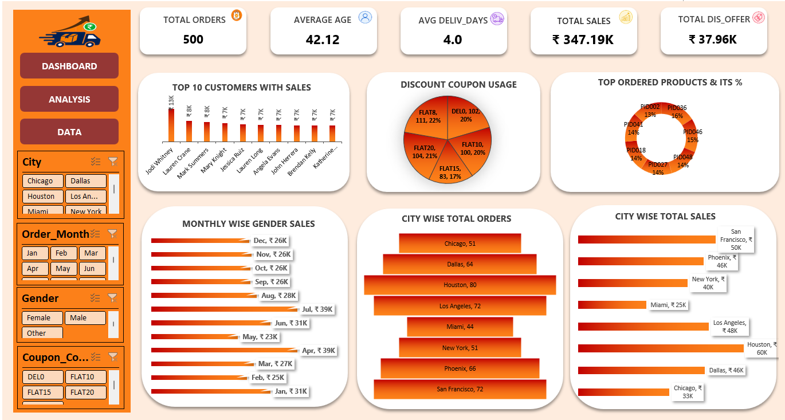

# Retail Sales & Delivery Analytics Dashboard

**Microsoft Excel | Data Analytics Portfolio Project**

## 1. Project Overview

This project focuses on analyzing retail sales and customer order data using Microsoft Excel. The primary objective is to transform raw transactional data into meaningful business insights by performing data preparation, applying Excel formulas, calculating key performance indicators (KPIs), creating Pivot Tables, and developing an interactive dashboard.

The analysis explores customer purchasing patterns, product performance, sales revenue, discount strategies, and order delivery performance to support data-driven business decisions.

## 2. Project Objectives

- Analyze customer demographics and purchasing behavior.
- Evaluate order volume and delivery performance.
- Identify the most frequently ordered products.
- Determine the highest revenue-generating products.
- Analyze sales revenue, discounts, and delivery charges.
- Understand city-wise and monthly sales trends.
- Develop an interactive dashboard for business performance monitoring.

## 3. Tools & Technologies

- Microsoft Excel
- Excel Formulas and Functions
- Pivot Tables
- Pivot Charts
- Data Analysis
- Data Visualization
- Interactive Dashboard

## 4. Data Preparation & Transformation

The following data preparation activities were performed:

- Created Full Name by combining First Name and Last Name.
- Calculated Order Amount using Price and Quantity.
- Generated Discount Percentage based on Coupon Codes.
- Calculated Discounted Amount.
- Calculated Amount Including Delivery Charges.
- Calculated Actual Days to Deliver.
- Categorized Delivery Status into Late, In Time, and Before Time.

## 5. Key Performance Indicators (KPIs)

**Customer Analysis**
- Total Unique Customers
- Customer with Highest Order Amount
- Average Customer Age

**Order & Delivery Analysis**
- Total Orders Placed
- Average Days to Deliver
- Orders with Zero Delivery Charges

**Product Analysis**
- Total Unique Products
- Most Ordered Product
- Highest Sales Generating Product

**Sales Analysis**
- Total Sales Amount
- Total Discount Offered
- Total Amount After Discount
- Total Amount After Discount and Delivery Charges

## 6. Data Visualization & Analysis

The project includes the following visualizations:

- Top 10 Customers by Total Sales – Bar Chart
- Top 7 Most Ordered Products – Donut Chart
- City-wise Total Orders – Funnel Chart
- City-wise Sales Performance – Bar Chart
- Discount Coupon Distribution – Pie Chart
- Monthly and Gender-wise Sales Analysis – Pivot Table and Clustered Bar Chart

## 7. Interactive Dashboard

An interactive Excel dashboard was developed to present important business KPIs and visual insights in a consolidated view.

The dashboard helps users understand sales performance, customer trends, product popularity, and delivery-related metrics.

## 8. Key Skills Demonstrated

- Data Preparation and Transformation
- Excel Formulas and Functions
- KPI Development
- Pivot Table Analysis
- Data Visualization
- Business Data Analysis
- Dashboard Development

## 9. Project Preview

## 10. Project Deliverable

The completed Excel workbook is available in this repository.

Download `Retail_Sales_Analysis.xlsx` and open it in Microsoft Excel to explore the analysis sheets, Pivot Tables, charts, and interactive dashboard.

---

**Project Category:** Data Analytics

**Tool:** Microsoft Excel

**Project Type:** Retail Sales Analysis
